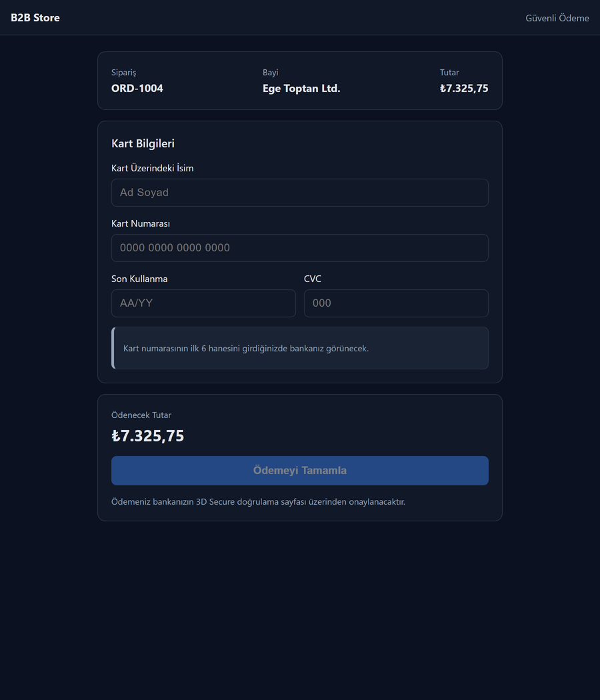
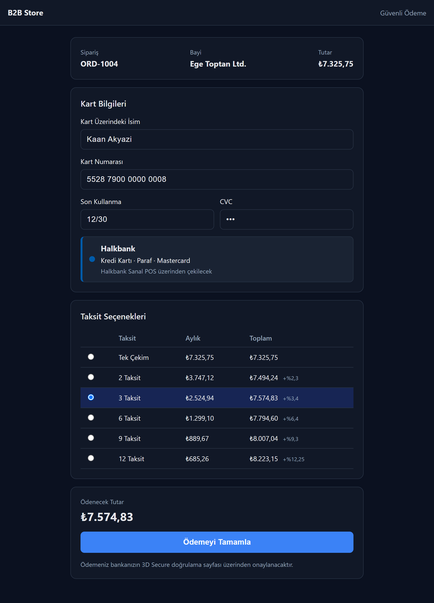
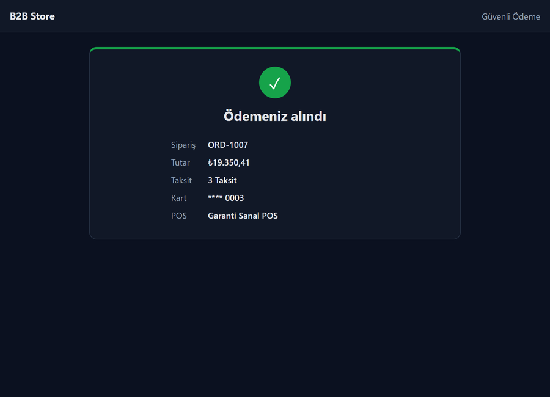

<h1 align="center">3D Secure Virtual POS Payment</h1>

<b>B2B checkout with BIN detection, installments and 3D Secure</b> C# · .NET 8 · Vue 3 · TypeScript · MSSQL · iyzico

## About

A dealer pays an order by card on a B2B store:

1. **BIN detection:** as soon as the first 6–8 digits are typed, the API finds the card's bank, type and program (e.g. Halkbank · Credit · Paraf · Mastercard) and the virtual POS to use.
2. **Installments:** the installment table (single payment, 2–12 installments) is calculated from that POS's commission rates; the total updates live.
3. **3D Secure:** payment starts on the server, the user is redirected to the bank's 3D Secure page, and the callback verifies and records the result.

## How it's built

- **Backend:** ASP.NET Core (.NET 8) REST API with **CQRS (MediatR)**, layered into Domain / Commands / Persistence, EF Core + MSSQL
- **Payment providers behind a strategy pattern** (`IPaymentProvider`): iyzico sandbox implemented; bank POS providers can be added without touching the flow
- `3ds/init` and `3ds/callback` endpoints; a repeated callback cannot pay an order twice; the order is marked paid only after the provider confirms
- **Frontend:** Vue 3 + TypeScript + Pinia + Vite: card form with formatting and validation, live BIN lookup, installment table, result page
- Seeded data for banks, BIN ranges, virtual POS definitions and commission rates

> Source code is private. This repository is a showcase.
